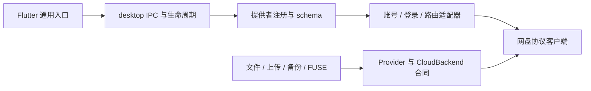

# 第三方存储接入与配套组件设计规范

规范版本：1.1 · 对应 Development 0.1.4 的实现。本文中的“必须”是后续适配器的验收条件；标为“规划”的接口尚未实现，不能据此宣称产品已支持。WebDAV/NAS、配对设备、Google Drive、OneDrive 为现有适配器，新增网盘按相同边界扩展。

## 1. 组件边界



| 组件 | 必须承担的职责 | 禁止承担的职责 |
| --- | --- | --- |
| Flutter `StorageClient`、`ProfileDialog`、文件页、托盘 | 消费 IPC/schema/能力；选择本地文件；显示进度、取消和可操作错误 | 根据 `kind` 拼 API URL、读取令牌、实现 OAuth/分块上传、复制另一网盘页面 |
| `desktop.rs` | 请求 ID、队列、取消、连接与 revision 绑定、工作进程所有权、状态与安全下载发布 | 具体网盘凭据字段、协议分支、OAuth scope 或分页语义 |
| `desktop_providers.rs` / `providers/<kind>.rs` | 唯一注册边界；公开 schema、身份/私有目录、连接/恢复/退出、网络策略、工作进程配方 | 将 token/临时上传 URL 放进公开列表或命令行 |
| `Provider` / `CloudBackend` | 元数据、浅层浏览、文件 ID、版本、流式传输、条件写入和冲突分类 | 界面状态、托盘几何、客户端安装或系统自启动 |
| 备份、挂载与恢复服务 | 在同一合同上记录意图、保留本地内容、校验账号身份并恢复 | 把路径当不透明远端 ID；绕过能力限制；复制协议客户端 |
| 平台组件 | 浏览器启动、私有文件保护、进程回收、原生托盘/文件选择、安装 | 云端 API 和提供者特定账号逻辑 |

源码入口：[Provider](../experiments/twodrive-dev/src/provider.rs)、[Profile](../experiments/twodrive-dev/src/profile.rs)、[注册边界](../experiments/twodrive-dev/src/desktop_providers.rs)、[Flutter 表单](../apps/dav/lib/profile_dialog.dart)。稳定 OneDrive 配置和 Development 私有账号目录保持独立。

## 2. 注册与配置 schema

新增适配器必须实现 `Provider + CloudBackend`，并在注册边界补齐 descriptor、prepare、validate、connect、restore、sign_out（适用时）及 action（适用时）。共享文件/备份服务与 Flutter 不增加该 `kind` 的分支。

`Profile` 公共信封：`id`、`revision`、`name`、`kind`、`writable`、`mount_path`、`network_route`；其他字段是适配器定义的扁平 `options`。`id` 标识本地配置，不是账号 ID；`revision` 由保存配置操作更新，不得由前端伪造为旧值。

| descriptor 字段 | 约定 |
| --- | --- |
| `id` / `label` / `account_label` / `icon` | 稳定的提供者键及界面名称；图标使用现有语义集合，未知值有通用回退 |
| `fields` | 声明唯一允许持久化的提供者字段；未知字段不得自动保存或公开 |
| field `key` / `label` / `required` | 字段键、用户标签与本地必填校验；引擎仍必须独立校验 |
| field `type` | 当前支持文本（省略）、`boolean`、`file`、`directory`；现有 JSON 文件选择器仅适合 JSON 凭据/邀请 |
| field `secret` | 公开列表仅返回 `<key>_saved`，不回显原值；空值仅在同一提供者且身份字段未变时保留旧凭据 |
| field `advanced` / `read_only` | 私有目录等内部路径放高级设置；一般添加连接使用自动目录；选定设备身份只读展示 |
| field `transient` | 表单输入意图；适配器 prepare 必须显式消费并移除，当前不是通用层自动擦除机制 |
| `identity_fields` | 影响凭据归属的字段；身份变化不得继承另一账号密码 |
| `protected_paths` | 凭据/身份/状态路径；备份不得把这些路径当上传源 |
| `network_modes` | 仅展示并允许已实现的 `auto` / `direct` / `system`；省略时现有表单展示三者，不表示适配器已经实现全部策略 |
| `actions` | 非文件操作的适配器动作，例如发现设备；由 `provider_action` 执行，不得暗中授权或改变其他账号 |
| `actions[].input_fields` | 动作需要的已声明非秘密配置字段；前端仅发送这些字段及公共 `network_route`，不自动提交其他表单或秘密字段 |
| `actions[].credential_fields` | 显式认证输入，必须同时声明 `transient=true` 与 `omit_from_profile=true`；普通存储表单不保存这些字段，适配器 prepare 仍须独立移除它们 |
| `login_action` | 适配器提供的图形登录动作 ID；公共 profile 的 `login_required=true` 时，“登录并使用”先调用该动作 |
| `capabilities` | UI 提示；实际连接的后端能力是执行依据，schema 的声明不代替服务端授权 |
| `mount_startup_timeout_seconds` | 独立冷启动预算，通用层当前限制 1～600 秒，默认 60；必须保持取消与进程回收 |

新增 schema 的最小示例（`example` 是示例，产品未注册）：

```json
{
  "id": "example",
  "label": "Example Drive",
  "account_label": "账号",
  "icon": "cloud",
  "help": "保存后连接，在系统浏览器完成授权。",
  "identity_fields": ["account_state"],
  "protected_paths": ["account_state"],
  "network_modes": ["system"],
  "capabilities": {
    "upload": false, "conditional_upload": false,
    "mkdir": false, "rename": false, "delete": false, "backup": false
  },
  "fields": [
    {"key": "account_state", "label": "私有登录目录（留空自动创建）", "advanced": true}
  ]
}
```

保存时默认目录应为独立的 `state/accounts/<profile-id>/<provider>`；Linux 挂载目录同样独立。不能将不同账号指向同一个令牌目录。在线新增/管理离线配置必须保持当前 `selected`、账号 binding 与 revision；所有已连接配置需断开后编辑/删除。切换浏览保留其他连接、挂载、备份及传输；断开或退出前仍须检查该账号的待上传缓存和运行任务。

### 多连接、传输归属与账号容量

引擎 `status.multi_connection=true` 时，`connections` 列出全部在线 profile 与 revision，顶层 `profile` 仅表示当前浏览对象。再次 `connect` 已在线 profile 只选择该会话，不重新认证或枚举根目录；连接新账号失败保留原连接。每次文件操作必须显式带原 `profile/revision`；传输期间切换浏览不能改变任务归属。同名路径也不得跨账号解析。上传、下载、容量查询最多同时执行八项，使用独立任务；控制队列及取消仍有预算。断开指定账号不影响其他账号；该账号仍有传输时拒绝断开，退出也拒绝未完成传输。容量任务可取消后收尾。前端保留各账号上次浏览目录并提供逐任务取消。

可选 Provider `storage_usage` 只返回数字 `total/used/free` 和 `scope=account`；全部未知返回不支持。IPC `quota` 同样绑定 profile/revision，错误只影响容量卡片。前端每账号缓存五分钟、合并重复请求，支持手动刷新；失败保留上次成功值并明确标记，revision 变更清空旧值。未知值不能显示为零，不能枚举整盘文件推算总额度。连接页用横条，托盘用小环形图，接近满额使用橙色；账号总空间可能与照片、邮件等共用。OneDrive 使用现有 Graph 权限读取 `/me/drive?$select=quota`，iCloud 复用既有加密 web session，详情见 [iCloud 指南](icloud-drive.md)。其他适配器未实现时明确显示不支持，不伪造容量。

客户端启动后按 `startup_ready` 恢复所有具有匹配 kind/revision/binding 的已保存会话，并在支持的平台逐个挂载；原浏览账号最后恢复，以保持选择。新增 `resume {id,revision}` 只能使用现有凭据，账号身份改变时拒绝发布连接；不自动打开授权网页或导入新的配对邀请。新配置无已保存会话时等待手动登录。某个账号连接/挂载失败要注明归属并继续恢复其他账号；退出时取消启动恢复及其挂载，不取消正在写入的用户文件传输。启动恢复不改旧配置 revision，挂载仍使用每条配置原有路径；不自动启用系统开机自启动。实际 Windows 本地验证及真实云端边界见 [多网盘验证记录](multi-cloud-2026-10-28.md)。

## 3. 登录入口与凭据生命周期

当前统一入口是 **添加连接 → 保存 → 登录并使用（或切换使用）**。OAuth 在适配器 `connect` 中完成；Google 要求外部导入桌面应用 JSON，OneDrive 使用既有公开应用 ID，WebDAV 使用显式服务地址与凭据，设备共享使用可信邀请。不能为了接入网盘再增加一个具有重复连接状态的独立登录页面。

登录必须遵守以下顺序：

1. 校验配置与明确账号目录；没有有效登录才打开系统浏览器/所需授权流程。后台 worker 只能恢复已有登录，不能擅自弹出授权页。
2. 生成随机 attempt/state 与 PKCE；严格校验回调方法、路径、state 和授权结果。回调监听限回环，授权 scope 与固定可信端点由适配器声明；导入文件中的任意 URL 不得覆盖 token 接收地址。
3. 浏览器启动参数作为 argv/环境数据，不能作为 shell 源码；父/子进程 stdout 必须保持仅 IPC JSON，禁止输出授权 URL、code 或令牌。
4. 保存登录必须采用现有私有文件组件：Unix 目录 0700/秘密文件 0600，Windows 使用支持的私有凭据保护/当前用户目录；不得提交用户 client JSON、令牌、身份私钥或上传会话。
5. 登录后探测稳定的账号/盘身份和用于展示的 `account_name`，生成 binding；不可仅按账号显示名称或 URL 判断同一身份。保存 worker session，恢复时校验 `kind + revision + binding`。
6. 取消或失败须释放回调监听、终止所属进程，保持已有缓存；不能将登录成功但盘不可用显示为已连接。暂时网络失败不能自动删令牌或反复弹浏览器。
7. 退出登录走通用入口并通过适配器移除本地登录；不删除云文件/备份源，设备配对的独立授权须按其明确生命周期处理。

`Connection.account_name` 由适配器提供，在 session 中随 kind/revision 保存；公开 profiles/status 只投影该展示字段，不公开 recipe、binding 或凭据。当前活动连接以引擎 status.profile 为准；名称不得参与身份比较。OneDrive 的展示探测使用 [Microsoft Get user `/me`](https://learn.microsoft.com/en-us/graph/api/user-get?view=graph-rest-1.0)，既有 User.Read 权限不变；展示失败不能让已可用的盘连接失败。

新版 UI 先请求 `subscribe {operations:true}`，引擎才发送可选 `event=operation` 通知（旧前端默认不接收，新前端遇旧引擎回退轮询）。通知包含 id/op/running，完成时附 status/configuration 公共快照；调用方须将事件与请求最终回复区分。重复 status/目录轮询必须合并，操作结束与窗口聚焦后刷新，轮询暂时错误在成功后恢复而不掩盖操作失败。队列保持有界且取消绕过排队；执行已取消的等待任务之前必须再次检查取消标志。事件不携带请求参数、秘密或远端正文。

刷新令牌需限制并发/重复重试，保存后只属于原账号目录；错误必须脱敏。路由策略、代理支持、权限申请、组织账号限制必须在适配器指南说明，并实际验证所声明范围。

**规划边界**：当前 IPC 没有统一 `auth_state` 枚举、独立 `login` 请求或在线授权升级流程。未来若新增，须定义 attempt ID、阶段、取消与超时、权限/账号变化后的 revision/binding 规则，再同步前后端与测试；不能只在 UI 增加按钮或把当前 `connect` 接口描述成已有这些字段。

图形认证可在现有 `provider_action` 返回一次性 `auth` 问题：`title/label/help/secret/required` 定义一个输入项，`attempt` 绑定当前步骤，`reply_action/cancel_action/context` 定义后续动作。`alternatives` 可提供短信等选项。`confirmation=true` 可隐藏输入框，显示可选的 `display_code/verification_url` 和 `submit_label`，供官方网页授权后确认；内部 device_code、令牌不能出现在显示字段。打开网页由适配器验证受信任地址后执行，前端仍不解释 OAuth 或网盘协议。答案只随本次私有 IPC 传递，不写入 profile、公开 status、operation 通知或日志。步骤切换销毁输入控制器，取消传回当前 attempt；过期或重放不得影响新尝试。适配器隐藏原始状态、密码默认值、令牌和协议错误正文，并在可取消进程边界内调用认证组件。成功返回 `authenticated=true` 及非秘密配置后，仍需保存并通过正常 connect 验证盘可用；登录成功不能伪装成已经连接。iCloud 的暂存配置与原账号配置分离，取消保留原登录；百度官方设备码授权与只读能力见 [百度预览说明](baidu-netdisk.md)。

## 4. 上传入口与数据合同

UI 手动上传入口必须由实际 `upload && (conditional_upload || manual_upload)` 能力共同开启；覆盖文件必须明确选择目标和现存版本。云盘默认可编辑，仍需服务端和适配器能力同时允许；成对设备授权由分享方决定。不能将“可以调用 PUT”直接等同于“支持安全覆盖/备份/读写挂载”。当前策略见 [默认可编辑](default-editable-2026-10-29.md)。

| 操作/值 | 必须保证的语义 |
| --- | --- |
| 路径 | 用于浏览/选择；统一验证绝对云路径、禁止 `..`/空组件/反斜杠/根删除；协议编码由适配器处理 |
| `remote_id` | 提供者不透明对象标识；下载/移动/删除用 ID，不能假定等于路径 |
| `etag` / version | 不透明版本；必须区分元数据版本与内容响应版本，不能跨资源强行使用同一个 ETag |
| 新建上传（无 version） | 原子 create-only，绝不覆盖已有对象；唯一名称命名空间中的同路径竞态必须失败。允许重名的服务须使用唯一对象身份创建、可逆 ID 别名，明确不能保证跨客户端名称唯一；不得偷偷改名冒充原目标成功 |
| 覆盖上传（有 version） | 对同一对象执行服务端版本比较；仅“先读取再覆盖”不能满足原子条件写入 |
| 进度/取消 | 流式、有界内存；回调失败或暂停后停止新分块/重试；上传进度不等于云端提交成功 |
| 分块/断点 | 提供者专属会话和服务端确认 offset；绑定账号、对象、条件与源内容，URL 仅在私有状态内保存；不伪造通用 resumable 能力 |
| 不确定成功 | 超时/丢失最后响应后先核对已提交对象/内容；不可盲目重放写操作。以内容哈希接受匹配结果，冲突保留本地版本 |
| 上传完成 | 返回可用于后续条件操作的明确对象 ID、路径、大小、版本；不可把“全部字节已发送”当作完成 |
| 下载发布 | 流式到临时文件，核对稳定版本/大小；成功后原子、不覆盖已有本地目标地发布；取消不发布半文件 |

`Provider::upload_controlled` 是桌面可取消上传合同；挂载/备份还会使用 `CloudBackend::upload_file_with_version`，两条入口必须具有相同条件写入语义。不能只修复手动上传而留下恢复 worker 的无条件覆盖。

现有手动入口是本地文件上传/明确替换，目录持续上传由文件夹备份服务提供；批量目录导入、在线文档原生编辑、共享盘/团队盘、移动前置条件、跨提供者复制等须另行定义和验收，当前不得推定已支持。无法安全条件写入的网盘可先提供只读适配器，关闭相关能力。

## 5. 浏览、同步、备份与挂载

浅层浏览只读取选中目录；分页须有数量/响应大小预算、循环/重复项处理和可信 nextLink 范围，不能将任何成功 JSON 当完整库存。增量 cursor 不透明，过期/不完整结果必须明确重建，失败不能冒充远端删除。重名、在线文档、包、外链或共享项须定义可逆显示/路径策略，不能把不可编辑对象显示为可写普通文件。

备份依赖 upload/mkdir/conditional_upload，记录本地内容意图及远端版本；扫描与上传能暂停/取消，登录变化须拒绝旧 session。旧有“本地删除不传播云端删除”的语义不因新增提供者改变。备份源需排除私有身份/凭据/状态目录和符号链接逃逸。

Linux FUSE 使用通用 Backend 与持久缓存，挂载完成前有独立冷索引预算；待上传内容、冲突和恢复状态不得因卸载/退出/清理缓存丢弃。Windows 文件浏览与传输不等于 Windows 挂载驱动支持。

Windows 原生挂载的私有 Provider 桥：HEAD 只查询元数据并复用条件头/范围响应，不下载正文；实际 GET 仍完整下载到临时缓存，核验版本、大小及适配器内容摘要后发布。不同文件的网络下载不持有全局缓存队列锁，同一对象/版本仍协调合并；共享缓存只在查找、LRU 和发布时短暂加锁。冷缓存首次真正读取仍可能等待网络和完整校验，不能保证零等待或把暖缓存体验当作首次下载性能。此机制修正及边界见 [TD-20261029-34](incidents.md#td-20261029-34客户端下载成功但挂载复制使资源管理器等待)。

## 6. 网络、桌面与辅助组件

协议客户端必须定义 TLS、重定向、可信凭据目标、代理/物理路由和超时。`auto` 真实发生兜底时报告结构化 warning；实际失败保持 error。不能把操作系统 LAN 路由、一次中继连接或同机 UDP 测试宣传成所有网络的 VPN 绕过/公网打洞。

托盘、浏览器启动、文件选择器和设备发现属于可复用配套组件。它们不得读取/缓存提供者令牌，也不得把发现等同授权。设备邀请必须匹配公钥、短时单次使用；登录导入文件和发现记录是输入数据，不是可执行指令。X11/Wayland 的图标定位规范见[独立指南](tray-positioning-2026-10-14.md)。

## 7. 新适配器验收与发布

提交新提供者必须同时交付：注册/schema、协议客户端、登录/刷新/退出/恢复、能力与冲突语义、字段脱敏、必要平台组件、使用文档和下列证据。缺少能力的行为必须明确关闭。

| 层次 | 必须验证的内容 |
| --- | --- |
| 合同测试 | 不透明 ID 区分路径、浅层分页、只读权限、create-only 竞态、旧版本拒绝、流式取消/暂停、危险默认能力不可用 |
| 登录测试 | PKCE/state/回调绑定，错误端点/重定向拒绝，刷新/退出/取消，凭据隔离与 IPC 脱敏 |
| 恢复测试 | 账号/盘/revision 变化拒绝旧缓存；上传丢响应/进程重启/源变更/冲突保留；旧格式只在语义兼容时迁移 |
| UI/IPC | 新 schema 不改 Flutter 提供者分支即可显示；在线新增不影响活动连接；当前连接操作绑定 profile/revision；秘密不在列表中 |
| 实际服务 | 在自有随机临时目录完成创建、上传、下载哈希、条件覆盖/旧版本拒绝、改名/删除/清理；标明账号类型/平台与未测范围 |
| 平台/分发 | Linux/Windows 原生构建和适用配套组件；安装不采用稳定账号状态、不自动启用自启动；包不含用户凭据/日志/私人文件清单 |

每个维护缺陷遵循 [AGENTS.md](../AGENTS.md) 与 [故障记录](incidents.md)，可复现缺陷应证明旧代码失败、修复通过。模拟 HTTP、同机 QUIC、虚拟 compositor 与真实云端结果必须分别报告；不能为了发布将未跑测试写为通过。

发布包必须包含程序、所需平台组件、安装/升级说明、本规范、源码归档、校验和及明确构建提交/CI 证据；Google 等需用户导入的桌面凭据不能随包发布。规范可独立作为 Release 附件。Breaking change 须先说明 schema/IPC/session 兼容策略，保留现有 profile 与未上传数据；当前规范版本号不是运行时已实现的 schema/IPC 版本协商。

## English contract summary

Add third-party drives only at the provider composition boundary. Flutter consumes schemas and capabilities; adapters own authentication, identity, private state, routing and worker recipes. The current login entry is save, then explicit Sign in and use / Switch; it reuses the guarded connect API. Public IPC must omit secrets. Restore binds provider kind, profile revision and account/drive identity.

Enable writing only with atomic create-only and version-checked replacement, bounded streaming, cancellation and recoverable ambiguous outcomes. Paths select entries; opaque IDs select remote objects; metadata and media versions may differ. Shared backup/FUSE services must use the same guarantees. Preserve pending local work on conflicts, logout, account changes and upgrades.

Ship protocol/auth/contract/UI/recovery regressions and clearly separate mock, isolated desktop and live cloud validation. Include this specification, supporting components, installers, source, checksums and verified build provenance in development releases; never include a user's credentials. Planned interfaces in this document are not implemented product features.


## 2026-10-28：显式手动写入与本机写入锁

本节的本机密码和重启只读为历史设计，已由 [2026-10-29 默认可编辑策略](default-editable-2026-10-29.md) 替代。手动写入与原子条件上传的区别、恢复副本和缓存隔离约束继续生效。

用户明确要求三家网盘的客户端及 Windows 挂载都可编辑，并要求修改前增加密码/锁。新增 `manual_upload_supported/manual_upload` 明确区分不具备原子 CAS 的手动编辑；原 `upload_controlled`、`upload_path/upload_snapshot` 与自动备份的原子版本合同保持不变。前端仅在实际 `upload && (conditional_upload || manual_upload)` 时允许手动上传，不使用网盘类型分支。iCloud/百度普通写入必须先保存原内容和编辑内容、核对版本、上传后核对内容，并公开不具备原子覆盖的边界；它们不因此获得 backup 能力。

通用 `set_access {profile,revision,mode,password?}` 从后端保存的原配置复制，仅修改权限及新 revision；密码校验通过后才解锁。在线切换先检查传输、卸载该账号，再非交互恢复相同 binding、发布实际新 worker recipe 并重新挂载。其余连接和选中浏览对象保留；失败尽量恢复原配置及挂载，不能改账号凭据。所有 provider 工厂按本机锁决定实际 writable，直接保存 writable=true 不能绕过密码。许可绑定 profile/revision/本次进程运行，底层变异和进度回调重复检查，读取不受写锁影响。重启恢复为已连接、已挂载的锁定只读状态。

Windows 持久缓存以账号 binding 摘要隔离，重启前的版本声明持久化，不能将旧缓存重新绑定新账号。未完成原生写入阻止普通权限切换/卸载/退出；异常结束仍保留编辑及版本，重启不越过写入锁自动上传。恢复说明及本地验证范围见 [Windows 写入锁](windows-write-lock.md)。Linux FUSE 的既有条件上传约束没有放宽，本轮可编辑挂载适配与验证范围为 Windows。
